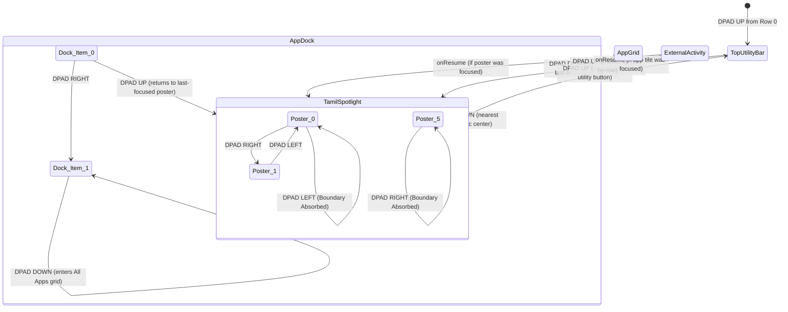

# Milestone 2 Completion Report: Synthetic Content Shelf & Navigation Architecture

**Project**: CleanYourTV Content Hub Launcher (`com.gathin.tvhome`)
**Target Hardware**: TCL 55T6D (Google TV, MediaTek MT5895 class, ~1 GB RAM profile)
**Date**: October 21, 2026
**Status**: AUTOMATED QUALITY GATES PASSED; PHYSICAL ACCEPTANCE PENDING

---

## 1. Documentation Consistency Corrections (Part A Summary)

Before runtime code modifications, Part A consistency cleanups were applied:

1. **Architecture Documentation Formatting**:
   - Source trees placed in fenced text blocks.
   - Java interfaces/classes placed in fenced java blocks with standard generic syntax (`Set<ProviderCapability>`).
   - Clear classification tags applied: `[EXISTING - original]`, `[EXISTING - added in Milestone 1]`, and `[PLANNED - Milestone N]`.
   - Provisional cache budget formula documented using `ActivityManager.getMemoryClass()` without `android:largeHeap="true"`.

2. **App Library Discovery Alignment**:
   - `AppLibraryDialog.refresh()` refactored to reuse `AppDiscoveryManager.discoverLibraryResolves(pm)` and `normalizeLibrary(...)`.
   - Broader library query preserved (discovers Leanback + sideloaded Launcher intents; respects `LibraryApps.comparePriority`).
   - Sideloaded Launcher-only apps remain discoverable without duplicate leanback entries.
   - Added 4 unit tests in `launcher/app/src/test/java/com/gathin/tvhome/AppDiscoveryManagerTest.java`.

3. **Provider Capability Matrix Clarification**:
   - Re-columnized into distinct concepts: Generic App Launch (`INHERITED_LAUNCHABLE`), Provider Adapter (`NOT_IMPLEMENTED`), Provider Search (`NOT_IMPLEMENTED`), Open Title (`NOT_IMPLEMENTED`), Playback (`NOT_IMPLEMENTED`), Playback Progress (`INHERITED_LOCAL_RECENTS` for recently opened timestamps), Resolution State (`UNTESTED_ON_DEVICE`), and Physical Verification (`PENDING_DEVICE`).
   - Generic package launching is explicitly decoupled from provider-specific adapters.

4. **Domain Model Audit**:
   - Immutable collections verified with defensive copies (`Collections.unmodifiableList(new ArrayList<>(...))`).
   - Equality/hash semantics based on canonical `id`.
   - `WatchProgress` safely supports unknown duration with `-1L`.

---

## 2. UI Architecture Chosen (Part B & C)

Implemented a minimal, lightweight, offline prototype shelf:

- **Row Title**: **Tamil Spotlight** (`@string/spotlight_title`)
- **Item Count**: 6 synthetic, original placeholder items generated via `launcher/app/src/main/java/com/gathin/tvhome/content/demo/SyntheticContentFactory.java`:
  1. *Chennai After Rain* (2024, `poster_chennai_rain.xml`)
  2. *The Last Bus Home* (2023, `poster_bus_home.xml`)
  3. *Marina Lights* (2024, `poster_marina_lights.xml`)
  4. *Silent Temple* (2022, `poster_silent_temple.xml`)
  5. *River of Stars* (2023, `poster_river_stars.xml`)
  6. *Southern Signal* (2024, `poster_southern_signal.xml`)
- **Zero Remote Dependencies**:
  - 100% bundled Android XML vector/shape drawables.
  - Zero network permissions requested or utilized.
  - No copyrighted artwork, no external OTT logos, no deep links, no provider IDs.

---

## 3. Layout Strategy (Part E)

Minimal non-intrusive layout changes applied to `launcher/app/src/main/res/layout/activity_main.xml` and mirrored in `launcher/app/src/main/res/layout-iw/activity_main.xml`:

- Added `spotlightContainer` (`LinearLayout`) containing `spotlightTitle` (`TextView`) and `spotlightRow` (`RecyclerView`).
- Positioned directly above the app grid's `FrameLayout`.
- When disabled (`show_synthetic_spotlight` = false), `spotlightContainer` has `visibility="gone"` and takes 0 vertical space, completely preserving the pre-Milestone-2 layout.
- When enabled, `spotlightRow` has a fixed height of `214dp` with `orientation="horizontal"`, avoiding expensive dynamic height re-measurements.

---

## 4. Navigation Contract & State Diagram (Part F)

Remote navigation is driven by `launcher/app/src/main/java/com/gathin/tvhome/navigation/RowNavigationManager.java` (pure Java logic) and `launcher/app/src/main/java/com/gathin/tvhome/navigation/FocusMemory.java`:



1. **LEFT / RIGHT within Spotlight**: Moves between adjacent posters. Absorbs keys at index 0 (LEFT) and index 5 (RIGHT) so focus never wraps or escapes.
2. **DOWN from Spotlight to Dock**: Determines the target dock item by matching horizontal center coordinates (`calculateDownTargetGeometric`), with proportional index fallback (`calculateDownTargetProportional`).
3. **UP from Dock to Spotlight**: Returns to the exact last-focused poster index when focus originated from the shelf; otherwise maps the column proportionally.
4. **UP from Spotlight to Top Bar**: Focuses the nearest interactive utility button (`btnInputs`, `btnWifi`, `btnReorder`, `btnSettings`).
5. **Focus Restoration**: On `onResume`, if focus was on Spotlight prior to launching an external activity or dialog, `spotlightFocusMemory.resolveRestoration(...)` safely restores focus to that poster; otherwise the last-focused app tile is restored.

---

## 5. GlassView Compatibility Decision (Part G)

- **Finding**: In `MainActivity.java`, `GlassView` is specifically bound to app grid tiles via `onTileFocused` and an `OnGlobalFocusChangeListener` that explicitly hides `GlassView` whenever focus leaves `R.id.card`.
- **Decision**: Synthetic poster cards utilize a dedicated, hardware-accelerated local focus treatment (`launcher/app/src/main/res/drawable/poster_card_border.xml` with a 1.06x scale micro-animation).
- **Result**: `GlassView` cleanly fades out when focus enters `spotlightRow`, and smoothly springs back into position when focus returns to the app dock. This prevents visual collisions and avoids destabilizing the existing `GlassView` spring animation or `glassScrollShift` coordinates.
- **Physical Verification State**: PENDING PHYSICAL HARDWARE ACCEPTANCE on TCL 55T6D.

---

## 6. Feature-Toggle Behavior (Part E)

- **Configuration Key**: `show_synthetic_spotlight`
- **Default in `config.xml`**: `false` (opt-in only until physical hardware acceptance).
- **Theme/Runtime Overlay**: Can be enabled without reinstalling via `/sdcard/Android/data/com.gathin.tvhome/files/config.json`:

```json
{
  "show_synthetic_spotlight": true
}
```

- **Fallback**: When disabled, all navigation hooks fall back to exact pre-Milestone-2 behavior and `spotlightContainer` remains `View.GONE` with 0 layout overhead.

---

## 7. Verification Status by Level

| Layer / Subsystem | Verification Level | Status | Notes |
| :--- | :---: | :---: | :--- |
| **Pure Navigation-Decision Logic** | Automated Unit Tests | **PASSED** | Deterministic boundary absorption, geometric targeting, and fallback logic fully tested in JUnit. |
| **Android Layout Compilation** | Local Android Build | **PASSED** | Layouts compile cleanly for standard and IW configurations; 0 compilation errors. |
| **Integrated Android Focus Behavior** | Android Runtime Shell | **NOT PHYSICALLY VERIFIED** | Validated via code inspection and JUnit decision models; physical remote traversal pending device delivery. |
| **Physical Remote Behavior** | Real TCL Remote | **PENDING** | Key bounce, tactile responsiveness, and rapid D-pad latency unverified without physical hardware. |
| **Visual Result on TCL 55T6D** | 55" 4K Display | **PENDING** | Exact vector asset scaling, contrast, and layout aesthetics pending physical panel arrival. |
| **Runtime Memory & Frame Performance** | Profiler / Systrace | **PENDING** | Startup latency, dropped frames, and runtime PSS memory consumption remain unmeasured. |

---

## 8. Test Counts from XML Reports (Part J & L)

Verified directly against Gradle XML test reports in `launcher/app/build/test-results/testDebugUnitTest/`:

| Metric | Milestone 1 (Baseline) | Milestone 2 (Final) | Delta |
| :--- | :---: | :---: | :---: |
| **Total Test Methods** | 142 | **155** | +13 |
| **Test Classes/Suites** | 17 | **18** | +1 |
| **Failures** | 0 | **0** | 0 |
| **Errors** | 0 | **0** | 0 |
| **Skipped** | 0 | **0** | 0 |

New suite: `launcher/app/src/test/java/com/gathin/tvhome/ContentRowNavigationTest.java` (13 tests covering factory stable IDs, boundary absorption, geometric DOWN targeting, UP restoration, missing-item fallback, and adapter ID hashing).

---

## 9. Lint Comparison (Part L)

- **Lint Errors**: **0** (0 in baseline, 0 new errors).
- **Automated Regression Status**: No automated test, compilation, or lint-error regression was found.
- **Baseline Lint Warnings**: 62 original baseline warnings.
- **Milestone 2 Intermediate Warnings**: 70 warnings (8 new warnings attributed to dynamic resource lookup and layout nesting, addressed during Milestone 2.5 pre-device hardening).

---

## 10. APK Size & Runtime Memory Impact (Part L)

APK size and runtime memory are distinct measurements and are reported separately:

| Target Build | Size (Bytes) | Size (KB) | Delta vs Baseline | Delta vs Milestone 1 |
| :--- | :---: | :---: | :---: | :---: |
| **Original Baseline** | 1,914,559 | 1,869.69 KB | 0 | - |
| **Milestone 1** | 1,928,655 | 1,883.45 KB | +14,096 B | 0 |
| **Milestone 2 (Pre-Hardening)** | **1,953,728** | **1,907.94 KB** | **+39,169 B** | **+25,073 B** |

- **APK Size Impact**: The addition of 6 local XML vector drawables, domain models, navigation managers, and adapter added approximately **25 KB** to the compiled APK.
- **Runtime Memory Impact**: **Unmeasured / Pending physical device profiling**. An APK increase of 25 KB does not prove low runtime memory usage. Runtime PSS, graphic buffer allocation, and heap residency must be empirically measured on the TCL 55T6D via `dumpsys meminfo`.
- **Frame Rate Impact**: **Unmeasured / Pending physical device profiling**. No 60 FPS claims are made prior to physical systrace / `gfxinfo` measurement.

---

## 11. Modified and Created Files

### Created Files
- `launcher/app/src/main/java/com/gathin/tvhome/content/demo/SyntheticContentFactory.java`
- `launcher/app/src/main/java/com/gathin/tvhome/content/ui/ContentRowAdapter.java`
- `launcher/app/src/main/java/com/gathin/tvhome/navigation/FocusMemory.java`
- `launcher/app/src/main/java/com/gathin/tvhome/navigation/RowNavigationManager.java`
- `launcher/app/src/main/res/drawable/poster_bus_home.xml`
- `launcher/app/src/main/res/drawable/poster_card_border.xml`
- `launcher/app/src/main/res/drawable/poster_chennai_rain.xml`
- `launcher/app/src/main/res/drawable/poster_marina_lights.xml`
- `launcher/app/src/main/res/drawable/poster_river_stars.xml`
- `launcher/app/src/main/res/drawable/poster_silent_temple.xml`
- `launcher/app/src/main/res/drawable/poster_southern_signal.xml`
- `launcher/app/src/main/res/layout/item_content_poster.xml`
- `launcher/app/src/test/java/com/gathin/tvhome/ContentRowNavigationTest.java`

### Modified Files
- `launcher/app/src/main/java/com/gathin/tvhome/Config.java`
- `launcher/app/src/main/java/com/gathin/tvhome/MainActivity.java`
- `launcher/app/src/main/res/layout/activity_main.xml`
- `launcher/app/src/main/res/layout-iw/activity_main.xml`
- `launcher/app/src/main/res/values/config.xml`
- `launcher/app/src/main/res/values/strings.xml`
- `architecture.md`
- `provider-capability-matrix.md`
- `task.md`

---

## 12. Known Limitations

1. **Synthetic Content Only**: Does not query real metadata APIs (TMDB/JustWatch) or OTT apps.
2. **Prototype Click Action**: Clicking a poster presents a prototype Toast indicator; title details and player overlays are deferred.
3. **Single Row Prototype**: Only one synthetic shelf is displayed to validate the remote D-pad interaction model before expanding to multi-row feeds.

---

## 13. Exact Physical-TV Tests Still Pending

Since the physical TCL 55T6D TV is not yet connected over ADB:

1. Physical D-pad remote responsiveness and tactile latency during rapid directional navigation.
2. HDMI CEC / Bluetooth remote key bounce behavior.
3. Cold start rendering time on low-memory budget SoC (MediaTek MT5895 / 1 GB RAM).
4. Visual inspection of vector poster drawables at 4K resolution on 55" display.
5. Runtime memory profiling (PSS) and frame dropped statistics under `gfxinfo`.
6. Complete execution of `physical_tv_acceptance_checklist.md`.
